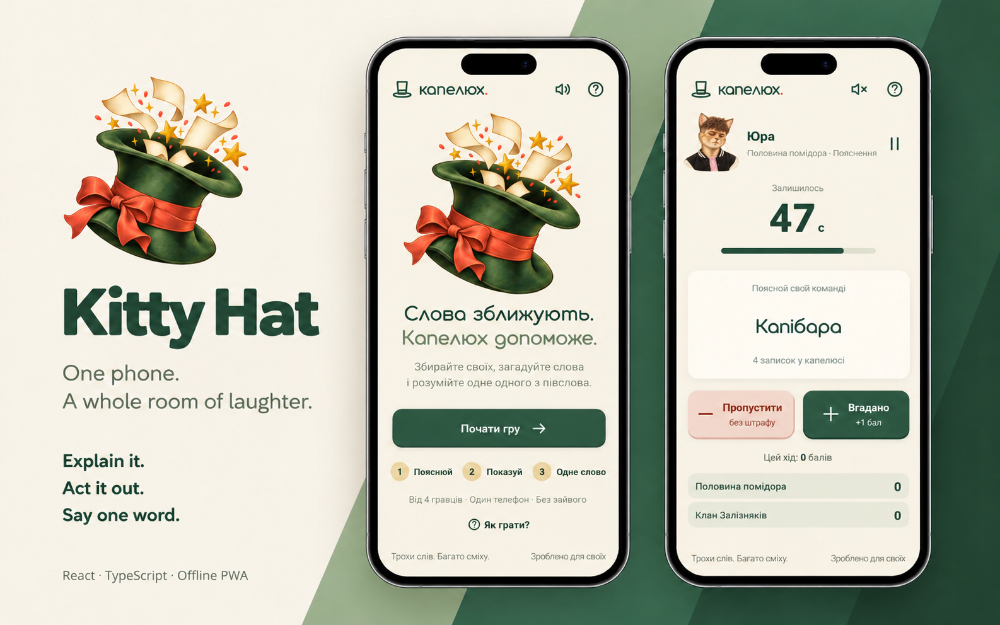
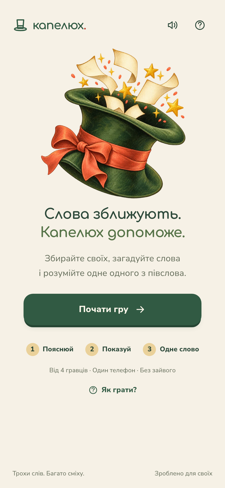
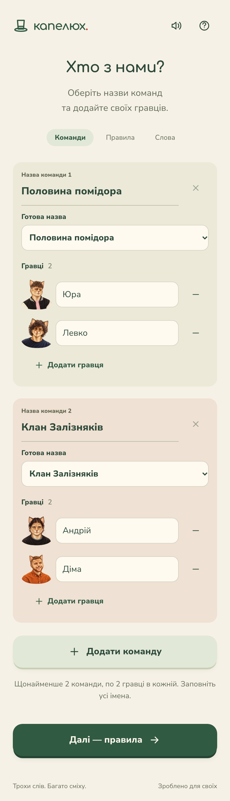
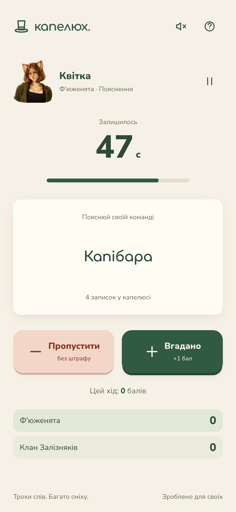
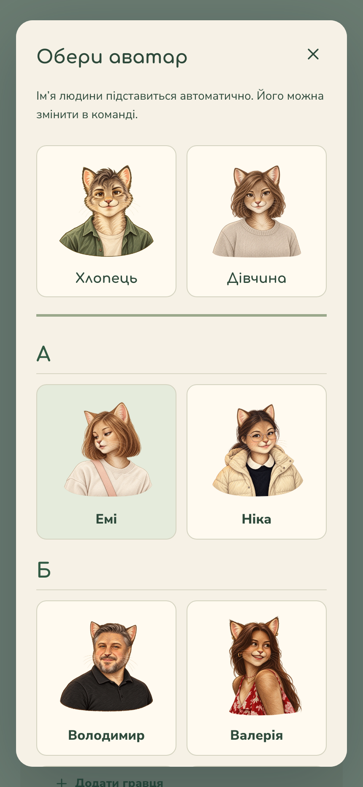
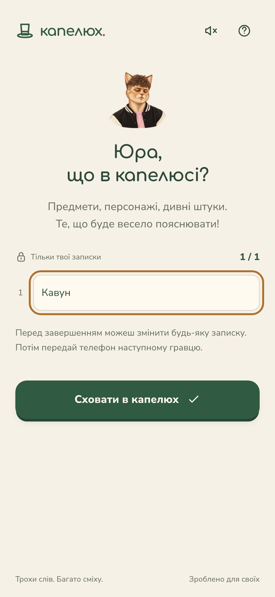
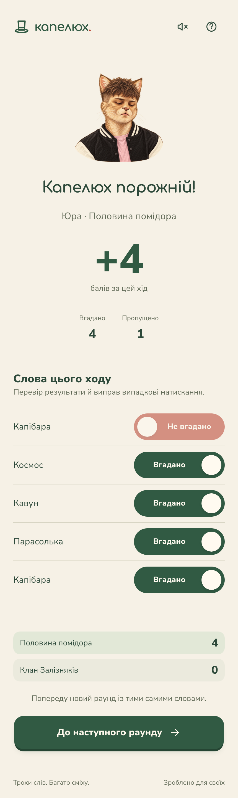
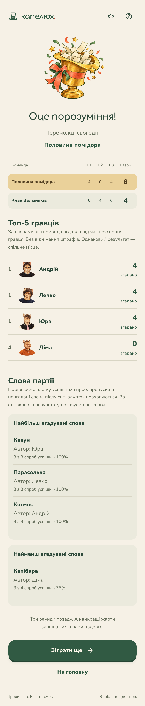

<p align="center">
  
</p>

<h1 align="center">Kitty Hat</h1>

<p align="center">
  <strong>One phone. A whole room of laughter.</strong><br />
  Explain it. Act it out. Say one word.
</p>

<p align="center">
  <a href="https://hat.dchurch.lviv.ua/">Play online</a> ·
  <a href="#screenshots">Screenshots</a> ·
  <a href="#how-to-play">How to play</a> ·
  <a href="#getting-started">Getting started</a>
</p>

**Kitty Hat** (Капелюх) is a Ukrainian word party game for friends sharing one phone. Split into teams, write your own secret words, and guess the same set across three rounds with increasingly limited clues.

Built with **React, TypeScript and Vite**, it runs entirely in the browser. Cat portraits, a paper-and-forest-green palette and large touch controls make it easy to pass around the room. Install it as a PWA, play offline after the first full load, and pick up a saved party later.



## How to play

1. **Gather your teams.** Add at least two teams with two players each. Choose cat avatars and use suggested or custom team names.
2. **Set your rules.** Pick 1–20 words per player, a 15–180 second turn timer, a skip policy and how to handle the final word at the buzzer.
3. **Fill the hat.** Pass the phone around so everyone can privately write words or short phrases.
4. **Play three rounds.** Teams take turns, and explainers rotate within each team. Every correctly guessed word earns one point.
5. **Review and celebrate.** Correct accidental taps after each turn, then compare team scores, the top five explainers and word statistics.

| Round | The challenge |
| --- | --- |
| 1 · Explain | Describe the word without saying it or using related forms. |
| 2 · Mime | Act it out without speaking, sounds or drawing letters. |
| 3 · One word | Give exactly one word as the clue. |

The same notes return for every round. Replay keeps the teams and settings and starts with fresh words and scores. The game interface is Ukrainian.

## Screenshots

Real screenshots from the application. Click any image to view it at full size.

<table>
  <tr>
    <th>Welcome</th>
    <th>Teams and cat portraits</th>
    <th>A timed turn</th>
  </tr>
  <tr>
    <td valign="top"><a href="docs/screenshots/home.png"></a></td>
    <td valign="top"><a href="docs/screenshots/teams.png"></a></td>
    <td valign="top"><a href="docs/screenshots/playing.png"></a></td>
  </tr>
</table>

<details>
  <summary>More screens: avatars, private words, turn review and final results</summary>

  <table>
    <tr>
      <th>Avatar picker</th>
      <th>Private word entry</th>
    </tr>
    <tr>
      <td valign="top"><a href="docs/screenshots/avatars.png"></a></td>
      <td valign="top"><a href="docs/screenshots/private-words.png"></a></td>
    </tr>
    <tr>
      <th>Review a turn</th>
      <th>Final scores and statistics</th>
    </tr>
    <tr>
      <td valign="top"><a href="docs/screenshots/turn-review.png"></a></td>
      <td valign="top"><a href="docs/screenshots/results.png"></a></td>
    </tr>
  </table>
</details>

## Features

- **A party on one device:** player-written notes, private handoffs, rotating explainers and three rounds with the same words.
- **Personal cat avatars:** named portraits autofill an editable first name. The picker groups and sorts people by surname; surnames stay hidden in the UI.
- **Flexible rules:** free skips, a one-point skip penalty or no skipping; strict timeouts or confirmation of an answer given before the signal.
- **Reliable timing:** pause/resume, sound cues in the last ten seconds, and an absolute deadline that prevents reloads from adding time.
- **Editable turn results:** switch a word between guessed and not guessed before handing off; scores and the remaining hat update accordingly.
- **Party statistics:** team scores by round, the top five explainers by successfully guessed words, and the highest/lowest word success rates with authors. Tied word results are shown together.
- **Local saves:** teams, settings, drafts, words, scores and turn history survive a refresh in the same browser and origin.
- **Offline PWA:** a standalone app window, home-screen icons, and cached code, portraits, illustrations and fonts. Updates wait until the old app's tabs/windows are closed.

## Install and play offline

Open [the game](https://hat.dchurch.lviv.ua/) while online and let it finish loading once.

- **iPhone/iPad:** open it in Safari, use **Share → Add to Home Screen**, and enable **Open as Web App** if offered.
- **Android:** use your browser's **Install app** or **Add to Home screen** action.
- **Desktop:** use the install action in a supported browser.

Installation options depend on the browser; see [MDN's installation guide](https://developer.mozilla.org/en-US/docs/Web/Progressive_web_apps/Guides/Installing).

Saves belong to the current browser and site address. Clearing site data removes the saved party; there is no cloud backup or device sync. Hidden words are protected by the interface, not encryption. A suspended browser or muted phone may suppress sounds, so use the visible timer.

## Getting started

Use **Node.js 22.12+ or 24+** and **pnpm**.

```sh
pnpm install
pnpm dev
```

Open [localhost:3000](http://localhost:3000/). To try the layout on a phone, connect to the same Wi-Fi and open Vite's printed network address. Service workers and PWA installation require HTTPS in production; use localhost for local PWA checks.

### Production preview

```sh
pnpm build
pnpm preview
```

Vite writes the static site, web app manifest and service worker to `dist/`. The PWA is enabled in production builds; the development server stays free of service-worker caching.

## Tech stack

| Layer | Technologies |
| --- | --- |
| Interface | React 19, TypeScript, CSS, self-hosted Comfortaa and Nunito fonts |
| Game state | React reducer, validated and migrated `localStorage` saves |
| Offline app | vite-plugin-pwa, Workbox, web app manifest, PNG and maskable icons |
| Build and hosting | Vite 7, pnpm, GitHub Pages with a custom domain |
| Checks | Vitest, Playwright, TypeScript, ESLint |

## Project structure

```text
src/
  App.tsx                  screens and game flow
  components.tsx           shared controls, dialogs and avatars
  game.ts                  rules, reducer, scoring and statistics
  storage.ts               save validation and migrations
  timer.ts                 turn timing and Web Audio cues
  style.css                responsive layouts and visual styles
data/
  teams.ts                 suggested team names
  persons/
    data.json              avatar names, surnames and filenames
    img/                   cat portraits and generation prompts
public/
  art/                     hat and victory illustrations
  fonts/                   local fonts and their licenses
  icons/                   PWA, Apple touch and favicon assets
  CNAME                    production domain
docs/
  assets/                  README preview and its generation prompt
  screenshots/             actual application screenshots
tests/                     browser scenarios and offline PWA checks
vite.config.ts             build, manifest and service-worker configuration
```

### Customize the players

Append a `{ "name", "surname", "img" }` entry to [the avatar catalog](data/persons/data.json) and place its image in [the portrait folder](data/persons/img/). Keep existing image filenames and catalog entries stable: saved games use the filenames to identify avatars. The first two entries are the generic boy/girl characters.

Portraits sort by **surname + first name**, using Ukrainian alphabetical order. An empty surname falls back to the first name. Add team-name suggestions in [`data/teams.ts`](data/teams.ts).

Illustrations and the promotional preview were created with ImageGen; prompt sidecars accompany the assets. The screenshot gallery shows the actual app. Font licenses are included in [`public/fonts/`](public/fonts/).

## Commands

| Command | Purpose |
| --- | --- |
| `pnpm dev` | Start development on port 3000 |
| `pnpm typecheck` | Check TypeScript types |
| `pnpm lint` | Run ESLint on source and game data |
| `pnpm test` | Run game and storage unit tests |
| `pnpm test:e2e` | Run browser scenarios against the development server |
| `pnpm test:pwa` | Build and test offline loading, cached assets and saved-game recovery |
| `pnpm build` | Type-check and build the production site |
| `pnpm preview` | Serve the production build locally |
| `pnpm run deploy` | Build and publish `dist/` to the `gh-pages` branch |

Install Chromium before running browser checks:

```sh
pnpm exec playwright install chromium
```

## Deployment

The site targets [hat.dchurch.lviv.ua](https://hat.dchurch.lviv.ua/). [`public/CNAME`](public/CNAME) preserves the custom domain, and Vite serves assets from `/`.

To publish manually, run `pnpm run deploy` with write access to the repository. In GitHub **Settings → Pages**, select the **gh-pages** branch and **/ (root)** folder. Use the explicit `run`: `pnpm deploy` is a separate pnpm workspace command.

## License

[MIT](LICENSE) © 2026 Yurii Khvyshchuk.

Bundled fonts retain their licenses in [`public/fonts/`](public/fonts/). The project license does not grant rights to anyone's name, likeness or endorsement.
